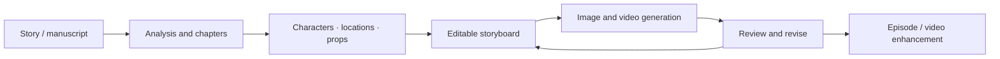

[中文](README.md) · English

<p align="center">
  
</p>

# NovelVids · 猫影短剧

**An open-source AI workspace for illustrated stories and short dramas.**

Bring stories, character assets, storyboards, AI images, video generation and episode assembly into **one project you can edit, track and keep refining**.

[](LICENSE)
[](#quick-start)
[](docs/english-production.md)

[Watch a sample](#see-the-result) · [Try the demo](https://demo.xiazq.com) · [Run locally](#quick-start) · [Documentation](#documentation) · [Contribute](CONTRIBUTING.md)

## See the result

[](https://youtu.be/fdiw__J19uk)

[Watch the complete clip on YouTube](https://youtu.be/fdiw__J19uk). Manuscript → characters and locations → storyboard → generated shots → episode. Results depend on the material, models and creative revisions.

**Explore before installing:** [open the live demo](https://demo.xiazq.com), username `demo`, password `NovelVids-Demo-2026`. Browse existing projects, assets, storyboards and videos. The demo is read-only and does not offer free generation; it resets daily at 00:00 Asia/Shanghai. Do not enter private data.

## Keep the creative process in one project

| Start with | What you can do |
| --- | --- |
| A story or manuscript | Import TXT, Markdown, DOCX or PDF, review chapter boundaries and story analysis, then work chapter by chapter |
| Characters, locations and props | Manage reference images, aliases and variants; reuse the same assets and voice bindings |
| A storyboard | Edit shot descriptions, complete prompts, reference media and generation parameters; inspect each result |
| An infinite canvas | Connect assets, videos and enhanced results; switch between storyboard and workflow views |
| A revision in mind | Ask the assistant to change selected objects, inspect diffs and recorded changes, and undo supported edits |
| Generated footage | Track tasks and versions, connect shots, assemble episodes and optionally enhance resolution |

You can also use **Remake studio** to analyze reference videos you are authorized to use and turn their shots into an editable project.

### Why a workspace?

- **Reusable settings.** Characters, variants, locations and voices stay linked to shots across chapters.
- **Editable steps.** Keep prompts and generation versions. Revise one shot before deciding whether to generate it again.
- **Shared capabilities for buttons and chat.** The assistant orchestrates creation; image and video models generate the media. Tasks and usage remain recorded.
- **Customizable creative rules.** One Chinese skill pack guides story analysis, assets, images and storyboards, with Chinese or English output selected by system language.
- **Your deployment, your providers.** Run on your computer or server and configure models for your budget and visual style.

### Real interface

**Infinite canvas: organize characters, locations, props and shots together.**

[](docs/images/screenshots/workbench.png)

| Character and location assets | Assistant and storyboard editing |
| --- | --- |
| [](docs/images/screenshots/asset.png) | [](docs/images/screenshots/creation-agent.png) |

Click an image for full size. [More screenshots](docs/screenshots.md). These captures show Chinese; the interface also supports English.

## Quick start

You need Docker with Docker Compose and access to model services. **Self-hosting is not offline inference:** AI features call the APIs you configure, and providers may charge for them.

```bash
git clone https://github.com/Anning01/novelvids.git
cd novelvids
docker compose up -d --build
```

Open **[http://localhost:8080](http://localhost:8080)** when startup completes.

Before creating your first project:

1. Under **Settings → Model settings**, enable a text model, select **Creation assistant**, and enable **Multi-turn tool calling**. Enable the assistant in General settings.
2. Configure the image/video models you want and their prices. A text model alone is enough to start planning stories, assets and storyboards.
3. Start with a short story or one chapter. Review extraction and storyboard results before generating media. Explicit generation requests can incur model charges; editing a prompt does not automatically generate images or videos.

The current Docker backend image does not include FFmpeg. Before video probing, composition, remake analysis or enhancement, install it in the backend container:

```bash
docker compose exec -u root backend sh -c 'apt-get update && apt-get install -y --no-install-recommends ffmpeg && rm -rf /var/lib/apt/lists/*'
docker compose exec backend ffprobe -version
```

Repeat this preparation after rebuilding the backend image. See [model setup and first run](docs/model-configuration.en.md) for configuration and troubleshooting.

- **Local persistence:** `./data` holds the database and private exports; `./media` holds images, video and audio. Back up both before updating.
- **No login by default:** intended for personal local use. Before public exposure, configure authentication and HTTPS using the [team deployment guide](docs/team-auth-deployment.md) (Chinese).
- **Local development:** Python 3.12+, Node.js 22.12+, uv and FFmpeg. See the [development guide](docs/development.en.md).

## Creative workflow



Use the storyboard to inspect each shot and the canvas to organize references and workflow. Accepted media tasks continue to be collected after you close the page. Uncertain submissions require review rather than an automatic repeat of a paid request.

## Documentation

| What you want to do | Guide |
| --- | --- |
| Learn the workflow, assistant, voices and workspace | [Creation guide](docs/creation-guide.en.md) |
| Configure models, prices and assistant budgets | [Model setup and first run](docs/model-configuration.en.md) |
| Produce English dialogue and reuse uploaded MP3/WAV voices | [English production](docs/english-production.md) |
| Improve image/storyboard prompts or add visual styles | [One skill pack](docs/agent-skills-workflow.en.md) |
| Enhance a clip or an episode | [Video enhancement](docs/video-enhancement.en.md) |
| Configure PostgreSQL, OSS, persistent media and backfills | [Database and storage](docs/storage.en.md) |
| Enable authentication, teams and deployment protections | [Team deployment](docs/team-auth-deployment.md) (Chinese) |
| Develop, understand the structure and run tests | [Development](docs/development.en.md) · [Contributing](CONTRIBUTING.md) |
| Check specific behavior | [Media library](docs/resource-library.md) · [Project metrics](docs/project-overview.md) · [Project name migration](docs/project-name-scoping.md) (Chinese) |

## Development and community

The frontend uses **Vue 3, TypeScript and Vue Flow**; the backend uses **FastAPI, Tortoise ORM and Pydantic AI**. Creative guidance lives in [`prompts/skills/`](prompts/skills/), separate from model adapters and task execution.

Bring a real creative problem: [report a bug](https://github.com/Anning01/novelvids/issues/new), [discuss an idea](https://github.com/Anning01/novelvids/issues), or [contribute](CONTRIBUTING.md). For generation problems, include a shareable minimal example, model configuration type and reproduction steps. Keep keys and private media out of reports.

Directions for discussion include **asset consistency, reproducible workflows, deployment and recovery, model/skill extensibility and production quality checks**. The [roadmap](ROADMAP.md) distinguishes current capabilities from proposed work; it is not a release commitment.

If NovelVids helps you, consider a Star, report your experience, or share work and production notes you are authorized to publish.

## License

Project code and documentation use the **[MIT License](LICENSE)**. Commercial use, modification and redistribution are permitted with the copyright and license notice retained. The software is provided as is, without warranty.

Third-party dependencies, fonts, media and model services retain their own terms. Demonstration content is not a grant of rights to underlying stories, music or voices. See [third-party notices](NOTICE.md).

<details>
<summary>Star history</summary>

[](https://github.com/Anning01/novelvids/stargazers)

</details>
