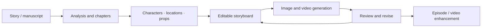

<p align="center">
  
</p>

<h1 align="center">NovelVids · 猫影短剧</h1>

<p align="center">
  <strong>An AI creation platform for illustrated stories and short dramas · hosted service and open-source self-hosting.</strong>
</p>

<p align="center">
  Bring stories, character assets, storyboards, AI images, video generation and episode assembly<br>
  into <strong>one project you can edit, track and keep refining</strong>.
</p>

<p align="center">
  <a href="LICENSE"></a>
  <a href="https://shortdramas.xiazq.com"></a>
  <a href="docs/english-production.md"></a>
</p>

<p align="center">
  <strong>English</strong> &nbsp;|&nbsp; <a href="README.md">简体中文</a>
</p>

<p align="center">
  <a href="#join-the-community">Join the community</a> · <a href="#video-tutorial">Video tutorial</a> · <a href="#example-videos">Example videos</a> · <a href="https://shortdramas.xiazq.com">Create online</a> · <a href="#quick-start">Get started</a> · <a href="#documentation">Documentation</a> · <a href="CONTRIBUTING.md">Contribute</a> · <a href="#support-the-project">Support the project</a>
</p>

## Join the community

Join the **NovelVids · 猫影短剧 WeChat group** to discuss AI animation, short dramas, model workflows and open-source deployment.

<p align="center">
  <a href="docs/images/wechat-group-qr.jpg"></a>
</p>

<p align="center">
  Scan with WeChat · <strong>Updated November 8, 2026; valid before November 15.</strong><br>
  Group QR codes expire after 7 days. If this one has expired, check the latest version of the repository home page.
</p>

## Create online

**[Open the NovelVids commercial service →](https://shortdramas.xiazq.com)**

Sign in with Qiling through WeChat. Start with an image or video idea, add reference material, or develop a story into a short drama. The hosted service provides model selection, team collaboration, usage records and top-ups. Generation fees follow the displayed estimates and actual usage.

For open-source self-hosting and development, see Quick start below and the [development guide](docs/development.en.md).

## Video tutorial

**[Watch the tutorial on Bilibili →](https://www.bilibili.com/video/BV12JW76dEkj/)**

Watch the tutorial to learn how to use NovelVids. For finished creations, see the example videos below.

## Example videos

**Commercial remake example**

[](https://youtu.be/fdiw__J19uk)

[Watch the commercial remake on YouTube](https://youtu.be/fdiw__J19uk)

**Illustrated drama example**

[](https://youtu.be/NAuIKfsSero)

[Watch the illustrated drama on YouTube](https://youtu.be/NAuIKfsSero) · Visual style: 3D xianxia; storyboard strategy: narrated storytelling. Generated automatically from story to finished video, without manually editing prompts or AI-generated prompts. Results depend on the material, models and creative revisions.

## Keep the creative process in one project

| Start with | What you can do |
| --- | --- |
| A visual idea | Choose an image or video model on the home page, reference images, video or audio, review the estimate and create a clip |
| A story or manuscript | Import TXT, Markdown, DOCX or PDF, review chapter boundaries and story analysis, then work chapter by chapter |
| Characters, locations and props | Manage reference images, aliases and variants; reuse the same assets and voice bindings |
| A storyboard | Edit shot descriptions, complete prompts, reference media and generation parameters; inspect each result |
| An infinite canvas | Connect assets, videos and enhanced results; switch between storyboard and workflow views |
| A revision in mind | Ask the assistant to change selected objects, inspect diffs and recorded changes, and undo supported edits |
| Generated footage | Track tasks and versions, connect shots, assemble episodes and optionally enhance resolution |

You can also use **Remake studio** to analyze reference videos you are authorized to use and turn their shots into an editable project.

### Why a workspace?

- **Reusable settings.** Characters, variants, locations and voices stay linked to shots across chapters.
- **Editable steps.** Keep prompts and generation versions. Revise one shot before deciding whether to generate it again.
- **Shared capabilities for buttons and chat.** The assistant orchestrates creation; image and video models generate the media. Tasks and usage remain recorded.
- **Customizable creative rules.** One Chinese skill pack guides story analysis, assets, images and storyboards, with Chinese or English output selected by system language.
- **Choose how to use it.** Create with the hosted service, or manage your own models, storage and deployment with the open-source edition.

### Current interface

**Home: select a model, reference material and start with an image or video clip.**

[](docs/images/screenshots/home.jpg)

| Storyboards and creation assistant | Infinite canvas workflow |
| --- | --- |
| [](docs/images/screenshots/creation-agent.jpg) | [](docs/images/screenshots/workbench.jpg) |

| Project assets | Works library |
| --- | --- |
| [](docs/images/screenshots/asset.jpg) | [](docs/images/screenshots/portfolio.jpg) |

Screenshots use public example projects in the current Chinese interface. English is also supported. [View the complete gallery](docs/screenshots.md).

## Quick start

1. Open the **[NovelVids commercial service](https://shortdramas.xiazq.com)**, read the agreements and sign in with Qiling through WeChat.
2. Choose an image or video model, enter a visual idea, add references and review the estimate. For a series, import a story through Short dramas and continue into assets and storyboards.
3. Review generated versions, revise shots, organize resources and manage finished episodes in the works library. Projects and costs belong to the currently selected team.

### Open-source self-hosting

The open-source edition lets you manage models, data and deployment. It runs anonymously by default; password login and team setup are covered in the [team deployment guide](docs/team-auth-deployment.md).

<details>
<summary>Expand Docker self-hosting and first-run configuration</summary>

You need Docker with Docker Compose and access to model services. **Self-hosting is not offline inference:** AI features call the APIs you configure, and providers may charge for them.

```bash
git clone https://github.com/Anning01/novelvids.git
cd novelvids
docker compose up -d --build
```

Open **[http://localhost:8080](http://localhost:8080)** when startup completes.

Before creating your first project:

1. Under **Settings → Model settings**, enable a text model, select **Creation assistant**, and enable **Multi-turn tool calling**. Enable the assistant in General settings.
2. Configure the image/video models you want and their prices. A text model alone is enough to start planning stories, assets and storyboards.
3. Start with a short story or one chapter. Review extraction and storyboard results before generating media. Explicit generation requests can incur model charges; editing a prompt does not automatically generate images or videos.

The current Docker backend image does not include FFmpeg. Before video probing, composition, remake analysis or enhancement, install it in the backend container:

```bash
docker compose exec -u root backend sh -c 'apt-get update && apt-get install -y --no-install-recommends ffmpeg && rm -rf /var/lib/apt/lists/*'
docker compose exec backend ffprobe -version
```

Repeat this preparation after rebuilding the backend image. See [model setup and first run](docs/model-configuration.en.md) for configuration and troubleshooting.

- **Local persistence:** `./data` holds the database and private exports; `./media` holds images, video and audio. Back up both before updating.
- **No login by default:** intended for personal local use. Before public exposure, configure authentication and HTTPS using the [team deployment guide](docs/team-auth-deployment.md) (Chinese).
- **Local development:** Python 3.12+, Node.js 22.12+, uv and FFmpeg. See the [development guide](docs/development.en.md).

</details>

## Creative workflow



Use the storyboard to inspect each shot and the canvas to organize references and workflow. Accepted media tasks continue to be collected after you close the page. Uncertain submissions require review rather than an automatic repeat of a paid request.

## Documentation

| What you want to do | Guide |
| --- | --- |
| Learn the workflow, assistant, voices and workspace | [Creation guide](docs/creation-guide.en.md) |
| Configure models, prices and assistant budgets | [Model setup and first run](docs/model-configuration.en.md) |
| Produce English dialogue and reuse uploaded MP3/WAV voices | [English production](docs/english-production.md) |
| Improve image/storyboard prompts or add visual styles | [One skill pack](docs/agent-skills-workflow.en.md) |
| Enhance a clip or an episode | [Video enhancement](docs/video-enhancement.en.md) |
| Configure PostgreSQL, OSS, persistent media and backfills | [Database and storage](docs/storage.en.md) |
| Enable authentication, teams and deployment protections | [Team deployment](docs/team-auth-deployment.md) (Chinese) |
| Develop, understand the structure and run tests | [Development](docs/development.en.md) · [Contributing](CONTRIBUTING.md) |
| Check specific behavior | [Media library](docs/resource-library.md) · [Project metrics](docs/project-overview.md) · [Project name migration](docs/project-name-scoping.md) (Chinese) |

## Development and community

The frontend uses **Vue 3, TypeScript and Vue Flow**; the backend uses **FastAPI, Tortoise ORM and Pydantic AI**. Creative guidance lives in [`prompts/skills/`](prompts/skills/), separate from model adapters and task execution.

Bring a real creative problem: [report a bug](https://github.com/Anning01/novelvids/issues/new), [discuss an idea](https://github.com/Anning01/novelvids/issues), or [contribute](CONTRIBUTING.md). For generation problems, include a shareable minimal example, model configuration type and reproduction steps. Keep keys and private media out of reports.

Directions for discussion include **asset consistency, reproducible workflows, deployment and recovery, model/skill extensibility and production quality checks**. The [roadmap](ROADMAP.md) distinguishes current capabilities from proposed work; it is not a release commitment.

If NovelVids helps you, consider a Star, report your experience, or share work and production notes you are authorized to publish.

## Support the project

If NovelVids helps you, consider supporting my work through WeChat Pay or Alipay. Your support helps me keep developing and maintaining the project. Thank you!

| WeChat Pay | Alipay |
| :---: | :---: |
| <a href="docs/images/donate-wechat.jpg"></a> | <a href="docs/images/donate-alipay.jpg"></a> |

## License

Project code and documentation use the **[MIT License](LICENSE)**. Commercial use, modification and redistribution are permitted with the copyright and license notice retained. The software is provided as is, without warranty.

Third-party dependencies, fonts, media and model services retain their own terms. Demonstration content is not a grant of rights to underlying stories, music or voices. See [third-party notices](NOTICE.md).

## Star history

[](https://github.com/Anning01/novelvids/stargazers)
