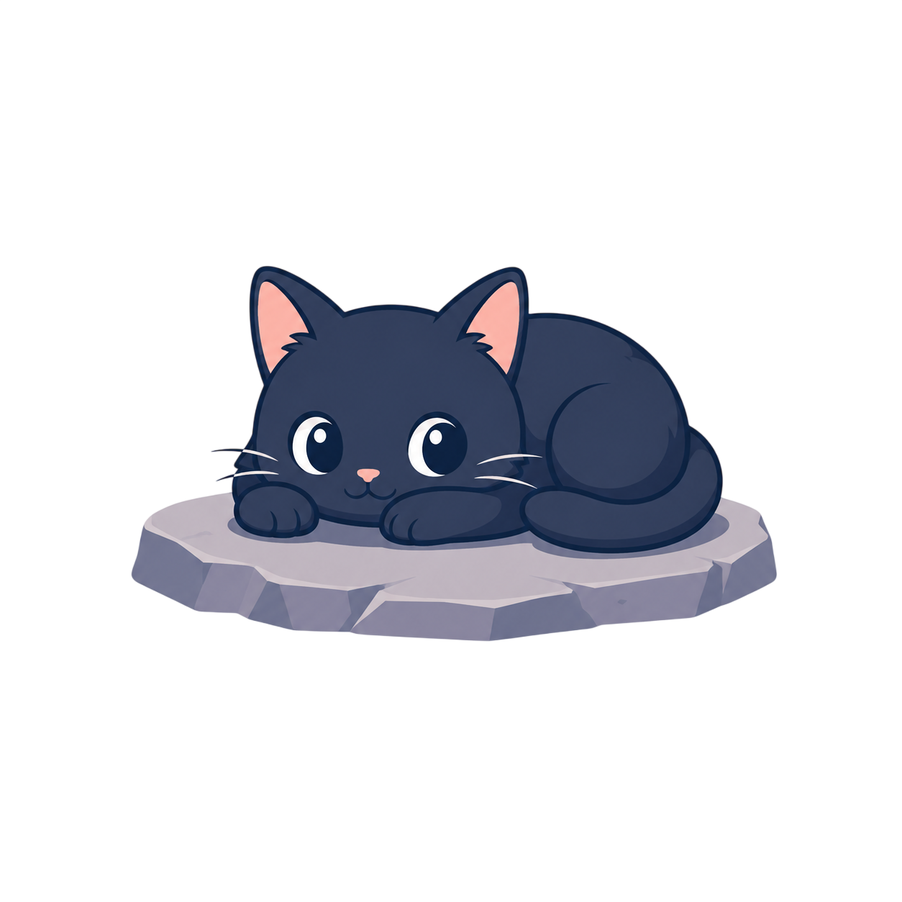
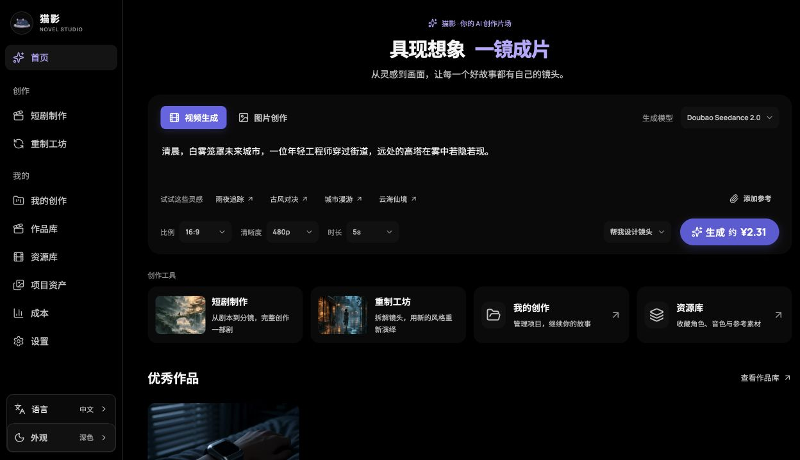
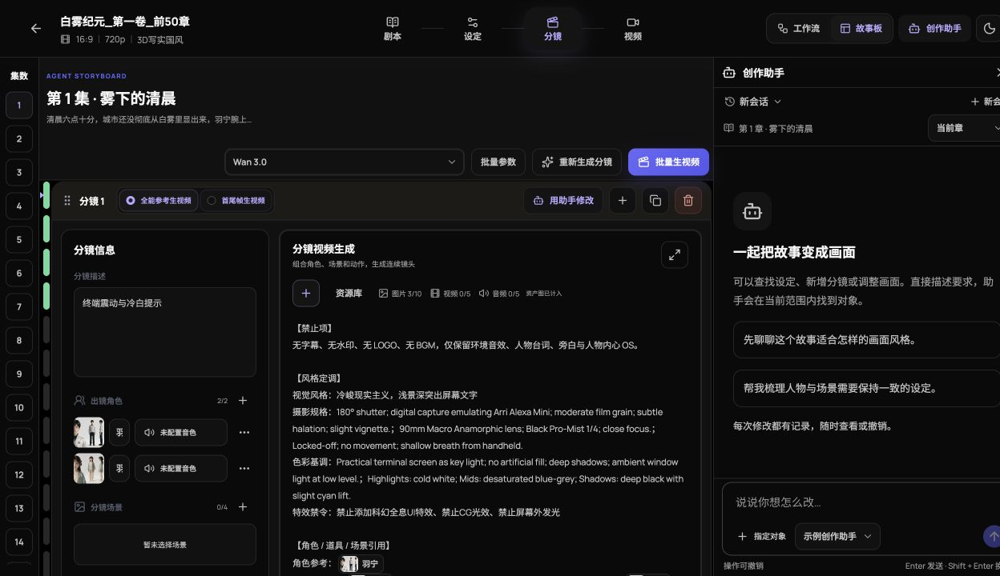
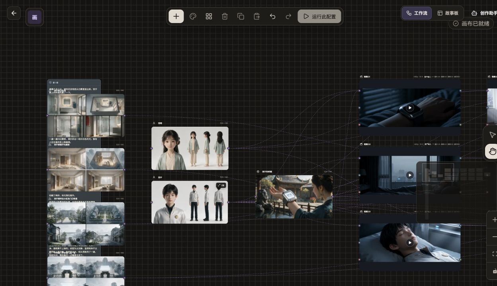
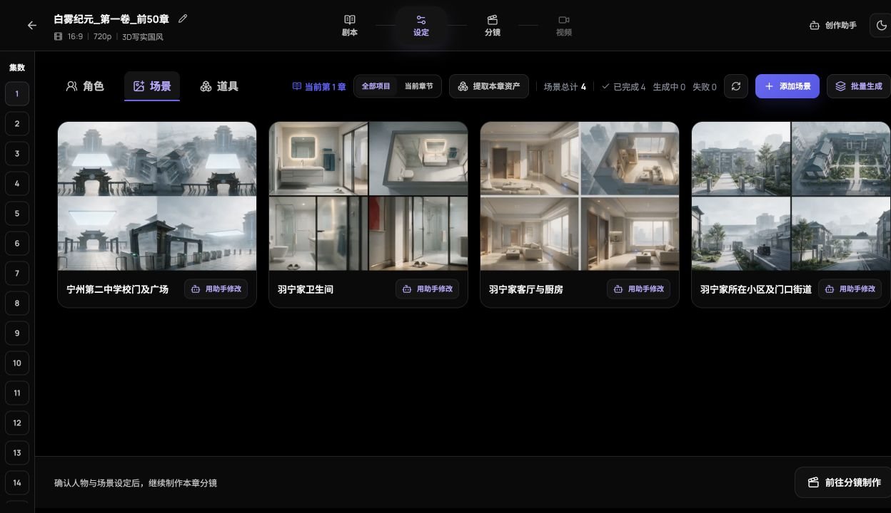
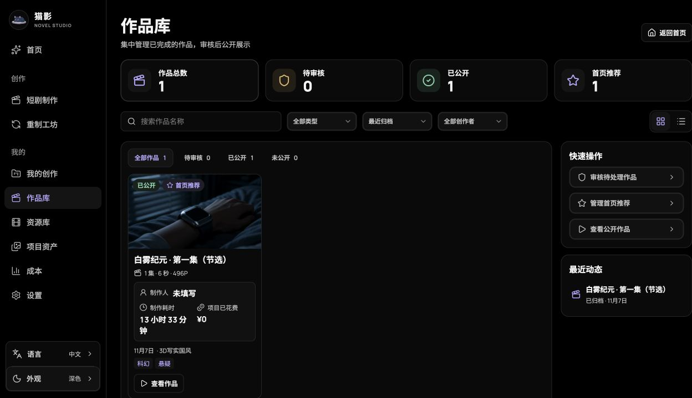
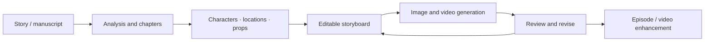

<p align="center">
  
</p>

<h1 align="center">NovelVids · 猫影短剧</h1>

<p align="center">
  <strong>An open-source local workspace for illustrated stories and short dramas, with your own models or the NovelVids developer platform.</strong>
</p>

<p align="center">
  Bring stories, character assets, storyboards, AI images, video generation and episode assembly<br>
  into <strong>one project you can edit, track and keep refining</strong>.
</p>

<p align="center">
  <a href="LICENSE"></a>
  <a href="https://shortdramas.xiazq.com"></a>
  <a href="README.md"></a>
</p>

<p align="center">
  <strong>English</strong> &nbsp;|&nbsp; <a href="README.md">简体中文</a>
</p>

<p align="center">
  <a href="#quick-start">Quick start</a> · <a href="#join-the-community">Join the community</a> · <a href="#video-tutorial">Video tutorial</a> · <a href="#example-videos">Example videos</a> · <a href="https://shortdramas.xiazq.com">NovelVids service</a> · <a href="#local-development">Local development</a> · <a href="#development-and-community">Contribute</a> · <a href="#support-the-project">Support the project</a>
</p>

## Quick start

Choose one option and send its prompt to your AI assistant.

**Download and run the studio**

```text
Download NovelVids from https://github.com/Anning01/novelvids, start it on my computer with Docker, and show me where to open the studio and import my novel.
```

**Use the creative skills on their own**

```text
Use scripts/export_skill.py from https://github.com/Anning01/novelvids to install the screenplay, asset design and storyboard skills in my current project, then show me how to use them on the first chapter of my novel.
```

## Join the community

Join the **NovelVids · 猫影短剧 WeChat group** to discuss AI animation, short dramas, model workflows and open-source deployment.

<p align="center">
  <a href="docs/images/wechat-group-qr.jpg"></a>
</p>

<p align="center">
  Scan with WeChat · <strong>Updated November 8, 2026; valid before November 15.</strong><br>
  Group QR codes expire after 7 days. If this one has expired, check the latest version of the repository home page.
</p>

## NovelVids service

**[Open the NovelVids commercial service →](https://shortdramas.xiazq.com)**

Sign in with Qiling through WeChat. The new developer platform provides a model catalog, API documentation, API keys, usage records and top-ups. See Local studio and developer platform for project migration.

This repository provides the creative workspace and creative rules. The developer platform is maintained separately as [Cat API](https://github.com/Anning01/cat-api). Workspace accounts, teams and balances are managed by the local deployment; platform accounts and model API billing are managed independently by Cat API.

## Video tutorial

**[Watch the tutorial on Bilibili →](https://www.bilibili.com/video/BV12JW76dEkj/)**

Watch the tutorial to learn how to use NovelVids. For finished creations, see the example videos below.

## Example videos

**Commercial remake example**

[](https://youtu.be/fdiw__J19uk)

[Watch the commercial remake on YouTube](https://youtu.be/fdiw__J19uk)

**Illustrated drama example**

[](https://youtu.be/NAuIKfsSero)

[Watch the illustrated drama on YouTube](https://youtu.be/NAuIKfsSero) · Visual style: 3D xianxia; storyboard strategy: narrated storytelling. Generated automatically from story to finished video, without manually editing prompts or AI-generated prompts. Results depend on the material, models and creative revisions.

## Keep the creative process in one project

| Start with | What you can do |
| --- | --- |
| A visual idea | Choose an image or video model on the home page, reference images, video or audio, review the estimate and create a clip |
| A story or manuscript | Import TXT, Markdown, DOCX or PDF, review chapter boundaries and story analysis, then work chapter by chapter |
| Characters, locations and props | Manage reference images, aliases and variants; reuse the same assets and voice bindings |
| A storyboard | Edit shot descriptions, complete prompts, reference media and generation parameters; inspect each result |
| An infinite canvas | Connect assets, videos and enhanced results; switch between storyboard and workflow views |
| A revision in mind | Ask the assistant to change selected objects, inspect diffs and recorded changes, and undo supported edits |
| Generated footage | Track tasks and versions, connect shots, assemble episodes and optionally enhance resolution |

You can also use **Remake studio** to analyze reference videos you are authorized to use and turn their shots into an editable project.

### Why a workspace?

- **Reusable settings.** Characters, variants, locations and voices stay linked to shots across chapters.
- **Editable steps.** Keep prompts and generation versions. Revise one shot before deciding whether to generate it again.
- **Shared capabilities for buttons and chat.** The assistant orchestrates creation; image and video models generate the media. Tasks and usage remain recorded.
- **Customizable creative rules.** One Chinese skill pack guides story analysis, assets, images and storyboards, with Chinese or English output selected by system language.
- **Choose your models.** Keep projects on your computer and connect your own model provider or the NovelVids developer platform.

### Current interface

**Home: select a model, reference material and start with an image or video clip.**

[](docs/images/screenshots/home.jpg)

| Storyboards and creation assistant | Infinite canvas workflow |
| --- | --- |
| [](docs/images/screenshots/creation-agent.jpg) | [](docs/images/screenshots/workbench.jpg) |

| Project assets | Works library |
| --- | --- |
| [](docs/images/screenshots/asset.jpg) | [](docs/images/screenshots/portfolio.jpg) |

Screenshots use public example projects in the current Chinese interface. English is also supported.

## Local studio and developer platform

This repository runs the creative workspace with `NOVELVIDS_ROLE=studio` by default. Deploy the developer platform from the separate [Cat API repository](https://github.com/Anning01/cat-api). Use **Export project** in the project menu and **Import project** in another local studio to restore a new project. The exporting browser downloads cloud media directly from storage, which must permit cross-origin reads from the studio origin.

Create a key for **Local Cat Shadow Studio** in the platform console. As a studio super administrator, open **Model configuration → Connect to the platform**, enter the key, and sync the models. The studio uses `https://shortdramas.xiazq.com/v1` by default. Set `STUDIO_PLATFORM_BASE_URL` to use a different platform address. The studio downloads completed videos directly to local storage.

The legacy `NOVELVIDS_ROLE=platform` role remains for existing deployments. New installations should deploy the studio and Cat API separately. Users of the retired online studio can download a complete project package from [Historical project migration](https://shortdramas.xiazq.com/#/legacy-works) and import it into a local studio. Preserve original projects and media, allow time for migration and notify users before switching services.

## Creative workflow



Use the storyboard to inspect each shot and the canvas to organize references and workflow. Accepted media tasks continue to be collected after you close the page. Uncertain submissions require review rather than an automatic repeat of a paid request.

## Online updates

On a Linux host using systemd and the standard SQLite Docker Compose deployment, run this once in the installation directory. The host needs Git and Python 3. Existing installations must first update their checkout to a release that includes the installer.

```sh
sudo sh scripts/update/install.sh
```

The deployment administrator can then click **Upgrade studio** in the top banner. The host builds images from the latest official GitHub Release, backs up SQLite, switches services and checks both versions. A failed health check restores the previous installation. The switch briefly interrupts service. The updater manages `docker-compose.override.yml` and keeps the existing project and media mounts. See `journalctl -u novelvids-update` for host logs.

After the upgrade, each user can save their edits and click **Refresh page**. For other deployment layouts, follow the release instructions.

**Publishing**. Update the version, summary and minimum feature versions in `release.json`. After testing, publish that commit as the latest stable GitHub Release with a matching tag (for example, `v1.1.0`). Keep `update_format: 1` for standard updates. Omit it and publish manual instructions for releases that change database deployment, mounts or Compose topology.

## Local development

Install Python 3.12+, Node.js 22.12+, uv and FFmpeg.

```bash
uv sync --frozen --dev
make dev PORT=9000
```

Start the frontend in another terminal:

```bash
cd web
npm ci
npm run dev
```

Open [http://localhost:3000](http://localhost:3000). The frontend proxies requests to the local backend on port 9000.

## Development and community

The frontend uses **Vue 3, TypeScript and Vue Flow**; the backend uses **FastAPI, Tortoise ORM, Deep Agents and Pydantic AI**. Creative guidance lives in [`prompts/skills/`](prompts/skills/), separate from model adapters and task execution.

Bring a real creative problem: [report a bug](https://github.com/Anning01/novelvids/issues/new), [discuss an idea](https://github.com/Anning01/novelvids/issues), or [contribute](https://github.com/Anning01/novelvids/pulls). For generation problems, include a shareable minimal example, model configuration type and reproduction steps. Keep keys and private media out of reports.

Directions for discussion include **asset consistency, reproducible workflows, deployment and recovery, model/skill extensibility and production quality checks**.

If NovelVids helps you, consider a Star, report your experience, or share work and production notes you are authorized to publish.

## Support the project

If NovelVids helps you, consider supporting my work through WeChat Pay or Alipay. Your support helps me keep developing and maintaining the project. Thank you!

| WeChat Pay | Alipay |
| :---: | :---: |
| <a href="docs/images/donate-wechat.jpg"></a> | <a href="docs/images/donate-alipay.jpg"></a> |

## License

Project code and documentation use the **[MIT License](LICENSE)**. Commercial use, modification and redistribution are permitted with the copyright and license notice retained. The software is provided as is, without warranty.

Third-party dependencies, fonts, media and model services retain their own terms. Demonstration content is not a grant of rights to underlying stories, music or voices. See [third-party notices](NOTICE.md).

## Star history

[](https://github.com/Anning01/novelvids/stargazers)

New creation-assistant conversations use the Python Deep Agents runtime for tool execution, on-demand skills and context compaction. Application services retain permission, version and output-contract checks. Conversation checkpoints default to `data/creation_agent_checkpoints.db`; set `CREATION_AGENT_CHECKPOINT_PATH` to change the location and include this state file in backups when retaining conversation recovery. Historical runs keep their original execution path.

The script workspace stores project visual style, audiovisual direction and an optional line-art storyboard switch (off by default). New shots can generate one storyboard image each; existing shots offer individual generation and retry. Images can be attached as video references with companion guidance. Installed official prompt optimizers are loaded from `CREATION_AGENT_OPTIONAL_SKILLS_PATH` (default `.agents/skills`) for the selected project video model. Generic and model-specific prompts are retained separately.
