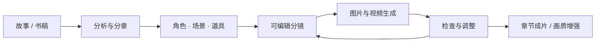

<p align="center">
  
</p>

<h1 align="center">猫影短剧 · NovelVids</h1>

<p align="center">
  <strong>开源 AI 漫剧与短剧创作平台，可在线使用，也可自行部署。</strong>
</p>

<p align="center">
  从故事、角色资产、分镜设计，到 AI 图片、视频生成与成片，<br>
  把整个创作过程放进一个<strong>可编辑、可追踪、能反复打磨的项目</strong>。
</p>

<p align="center">
  <a href="LICENSE"></a>
  <a href="https://shortdramas.xiazq.com"></a>
  <a href="README.en.md"></a>
</p>

<p align="center">
  <a href="README.en.md">English</a> &nbsp;|&nbsp; <strong>简体中文</strong>
</p>

<p align="center">
  <a href="#加入交流群">加入交流群</a> · <a href="#使用教程">使用教程</a> · <a href="#作品示例">作品示例</a> · <a href="https://shortdramas.xiazq.com">进入商业站</a> · <a href="#快速开始">开始创作</a> · <a href="#本地开发">本地开发</a> · <a href="#开发与社区">参与贡献</a> · <a href="#赞赏支持">赞赏支持</a>
</p>

## 加入交流群

欢迎加入 **猫影短剧 · NovelVids 微信交流群**，交流 AI 漫剧、短剧制作、模型使用与开源部署。

<p align="center">
  <a href="docs/images/wechat-group-qr.jpg"></a>
</p>

<p align="center">
  微信扫码入群 · <strong>当前二维码于 2026 年 11 月 8 日更新，11 月 15 日前有效。</strong><br>
  二维码有效期为 7 天；如已失效，请查看仓库首页的最新版本。
</p>

## 在线创作

**[进入猫影商业站 →](https://shortdramas.xiazq.com)**

使用器灵账号微信扫码登录，从一句想法开始生成图片或视频，也可以把故事推进成系列短剧。在线版提供模型选择、参考素材、团队协作、用量记录与充值入口；生成费用以页面展示的报价和实际用量为准。

本站使用本仓库的源码和创作规则。自行部署也包含器灵登录、团队协作、用量账单和微信支付接入，所需服务由部署者配置。

## 使用教程

**[观看 B 站使用教程 →](https://www.bilibili.com/video/BV12JW76dEkj/)**

想了解猫影短剧怎么用，可以先看视频教程；生成的成片效果见下方「作品示例」。

## 作品示例

**商业复刻示例**

[](https://www.bilibili.com/video/BV1U74P6hEpx/)

[在 B 站观看商业复刻示例](https://www.bilibili.com/video/BV1U74P6hEpx/)

**漫剧制作示例**

[](https://www.bilibili.com/video/BV1U74P6hEzD/)

[在 B 站观看漫剧制作示例](https://www.bilibili.com/video/BV1U74P6hEzD/) · 视觉风格：3D仙侠；分镜策略：旁白叙事。从故事到成片自动生成，全程没有人工修改提示词或 AI 生成的 Prompt。实际效果取决于素材、模型和创作调整。

## 在一个项目里完成创作

| 从哪里开始 | 你可以做什么 |
| --- | --- |
| 一句画面描述 | 从首页选择图片或视频模型，引用图片、视频或音频，查看报价并生成独立片段 |
| 一段故事或小说 | 导入 TXT、Markdown、DOCX、PDF，检查分章与故事分析，逐章推进 |
| 角色、场景与道具 | 管理参考图、别名、变装与衍生形态，复用同一资产和声音绑定 |
| 一组分镜 | 编辑镜头描述、完整提示词、参考素材和生成参数，检查每次结果 |
| 一张无限画布 | 连接素材、视频与高清结果，在故事板和工作流之间切换 |
| 一个修改想法 | 让创作助手调整指定对象，查看差异、保存回执与可撤销修改 |
| 已生成的视频 | 跟踪任务与版本、衔接镜头、合并章节成片，按需做画质增强 |

也可以从有权使用的参考视频进入**重制工坊**，分析镜头并建立可编辑的创作项目。

### 为什么用工作台，而不是把过程散在几个工具里？

- **设定可以复用。** 角色、形态、场景和声音与分镜关联，跨章节沿用项目资产。
- **每一步可以修改。** 保留提示词与生成版本；可以只调整一个镜头，再决定是否生成。
- **按钮与对话用同一套能力。** 创作助手负责编排，图片和视频模型负责生成，任务与用量有记录。
- **规则可以自己改。** 故事、资产、生图和分镜规则集中在一套中文 Skills；按系统语言输出中文或英文。
- **按需要选择使用方式。** 可以直接在猫影站点创作，也可以自行部署，管理自己的模型服务和数据。

### 新版界面

**首页：选择模型、引用素材，从图片或视频片段开始。**

[](docs/images/screenshots/home.jpg)

| 分镜与创作助手 | 无限画布工作流 |
| --- | --- |
| [](docs/images/screenshots/creation-agent.jpg) | [](docs/images/screenshots/workbench.jpg) |

| 项目资产 | 作品库 |
| --- | --- |
| [](docs/images/screenshots/asset.jpg) | [](docs/images/screenshots/portfolio.jpg) |

截图使用公开示例项目，展示当前版本的中文界面；系统也支持英文。

## 快速开始

1. 打开 **[猫影商业站](https://shortdramas.xiazq.com)**，阅读协议并通过器灵微信扫码登录。
2. 在首页选择图片或视频模型，填写画面描述、添加参考素材并核对预计费用；也可以从「短剧制作」导入故事，进入资产与分镜工作区。
3. 查看生成结果与历史版本，继续编辑镜头、整理资源，或在作品库管理成片。团队和费用归属以当前选中的团队为准。

### 自行部署

默认可匿名在本地创作。资产设计模板、分镜语速规则和 15 套视觉风格随源码提供，统一在 `prompts/skills/` 编辑。

<details>
<summary>展开 Docker 自部署与首次配置步骤</summary>

需要 Docker 与 Docker Compose，以及可用的模型服务。**自部署不等于离线推理**：当前 AI 能力通过你配置的 API 调用，供应商可能收费。

```bash
git clone https://github.com/Anning01/novelvids.git
cd novelvids
docker compose up -d --build
```

启动后打开 **[http://localhost:8080](http://localhost:8080)**。

首次创作前：

1. 在「设置 → 模型配置」添加并启用文本模型，勾选「创作助手」和「支持多轮工具调用」；在通用设置中启用助手。
2. 配置要使用的图片、视频模型和价格。只配置文本模型，也可以先做故事、资产和分镜规划。
3. 从一段短故事或一章正文开始，检查提取与分镜结果，再生成媒体。明确的生成请求会调用付费模型；只改提示词不会自动生图或生视频。

Docker 后端镜像已包含 FFmpeg；使用旧镜像时，可安装并检查：

```bash
docker compose exec -u root backend sh -c 'apt-get update && apt-get install -y --no-install-recommends ffmpeg && rm -rf /var/lib/apt/lists/*'
docker compose exec backend ffprobe -version
```

可用 `docker compose exec backend ffprobe -version` 检查视频工具是否就绪。

- **数据在本地：**`./data` 保存数据库和私有导出，`./media` 保存图片、视频、音频；更新前备份这两个目录。
- **默认无登录：**适合个人本地使用。公网部署前，请通过环境变量配置 `AUTH_ENABLED=true`、`AUTH_PROVIDER=password`、`SUPER_ADMIN_USERNAME` 和 `SUPER_ADMIN_PASSWORD`，并启用 HTTPS。
- **器灵扫码登录：**设置 `AUTH_ENABLED=true`、`AUTH_PROVIDER=qiling` 和器灵服务的 HTTPS 地址 `QILING_API_BASE_URL`。开放新账号注册时设置 `QILING_SIGNUP_ENABLED=true`，并填写 Compose 中的 `LEGAL_*` 运营者、协议与第三方信息。
- **微信支付与远程重制：**启用充值时，为后端配置自己的 `WECHAT_PAY_*` 商户参数和回调地址（站点的 `/api/payment/wechat/notify`），通过 Compose 覆盖文件把密钥文件只读挂载到配置的容器路径。重制默认在本机处理；已安装媒体工作进程时，填写 `REMAKE_MEDIA_SSH_HOST` 并为后端配置 SSH 身份和已验证的主机公钥。
- **本地开发：**Python 3.12+、Node.js 22.12+、uv 与 FFmpeg，步骤见下方「本地开发」。

</details>

## 创作流程



故事板适合逐镜头检查，画布适合组织引用与工作流。开始生成后可以关闭页面，后台继续查询已受理任务；结果不确定时需核对，不会自动重复提交收费请求。

## 单独使用创作技能

只做某个环节时，可以把对应的技能包装进支持 `SKILL.md` 的助手，直接在会话里提供正文、剧本或参考资料。独立包包含入口、该环节引用的规则和 MIT 许可证，可以将其目录内容放入单独的开源仓库。

| 环节 | 技能名 | 交付内容 |
| --- | --- | --- |
| 故事分析 | `novelvids-story` | 基于原文的大纲、人物弧光与出处 |
| 剧本改编 | `novelvids-screenplay` | 分场剧本、动作与对白 |
| 资产设定 | `novelvids-assets` | 人物、群像、场景、道具和形态的完整设计 |
| 分镜制作 | `novelvids-storyboard` | 镜头、资产引用与人声时间轴 |
| 生图提示词 | `novelvids-image` | 资产参考图或封面的完整提示词 |
| 视频制作 | `novelvids-video` | 逐镜提交清单、衔接与成片要求 |
| 视频拆解 | `novelvids-remake` | 来自参考视频的资产与逐镜制作资料 |

改稿时继续使用负责该产物的技能，例如用资产设定修改某一章的服装形态，用分镜制作调整对白时间轴。跨章节、跨环节的步骤编排由宿主 Agent 负责。

从仓库根目录导出或安装一个技能，只需 Python 标准库：

```bash
python3 scripts/export_skill.py --list
python3 scripts/export_skill.py novelvids-storyboard --dest ./output/skills
python3 scripts/export_skill.py novelvids-screenplay --dest .agents/skills
```

第一条列出可选环节。第二条生成可独立发布的目录 `output/skills/novelvids-storyboard/`。第三条安装剧本技能到当前项目；在该项目的会话中可用 `$novelvids-screenplay` 指定它。例如：“把下面这一章改成 60 秒短剧，保留结尾那句对白。”

分镜技能支持项目全局的「故事版」开关，默认关闭。在作品根目录运行 `python3 .agents/skills/novelvids-storyboard/scripts/storyboard_sheets.py on` 开启，或用 `off` 关闭。开启后，每个生成段交付一张简约黑白线稿故事版和配套视频提示词，图内格数随动作与构图变化。

规则源文件位于 `prompts/skills/novelvids-*/references/`。各包的 `SKILL.md` 说明输入、交付物与所需规则。导出时共享规则会复制进包内，因此只装分镜也能使用其风格、叙事和语速规则。独立包可以直接编辑；更新有本地修改的安装时，先导出到新目录再比较。工作台继续负责数据、媒体和任务执行，单独使用技能时由实际接入的助手工具提供这些能力。

## 本地开发

需要 Python 3.12+、Node.js 22.12+、uv 与 FFmpeg。

```bash
uv sync --frozen --dev
make dev PORT=9000
```

另开终端启动前端：

```bash
cd web
npm ci
npm run dev
```

打开 [http://localhost:3000](http://localhost:3000)。前端代理指向本地后端的 9000 端口。

## 开发与社区

前端使用 **Vue 3、TypeScript、Vue Flow**，后端使用 **FastAPI、Tortoise ORM、Pydantic AI**。创作规则位于 [`prompts/skills/`](prompts/skills/)，模型适配与任务执行保持独立。

欢迎带着实际创作问题参与：[报告问题](https://github.com/Anning01/novelvids/issues/new) · [讨论需求](https://github.com/Anning01/novelvids/issues) · [提交贡献](https://github.com/Anning01/novelvids/pulls)。报告生成问题时，提供可公开的最小样例、模型配置类型和复现步骤，别附 Key 或私人素材。

后续重点围绕**资产一致性、可复现工作流、部署恢复、模型与 Skills 扩展、成片质量检查**讨论和推进。

如果 NovelVids 帮到了你，欢迎 Star、反馈使用体验，或分享有权公开的作品与制作过程。

## 赞赏支持

如果这个项目对你有帮助，欢迎通过微信或支付宝赞赏，支持我继续开发和维护猫影短剧。感谢你的支持！

| 微信支付 | 支付宝 |
| :---: | :---: |
| <a href="docs/images/donate-wechat.jpg"></a> | <a href="docs/images/donate-alipay.jpg"></a> |

## 许可证

项目代码和文档采用 **[MIT License](LICENSE)**，允许商业使用、修改与再分发，须保留版权及许可声明。软件按原样提供，不附带保证。

第三方依赖、字体、素材和模型服务仍遵循各自许可；演示内容不代表授予第三方小说、音乐或声音的使用权，详见[第三方声明](NOTICE.md)。

## Star 历史

<!-- star-growth-card:start -->
<p align="center">
  <a href="https://github.com/Anning01/novelvids/stargazers">
    
  </a>
</p>
<!-- star-growth-card:end -->
