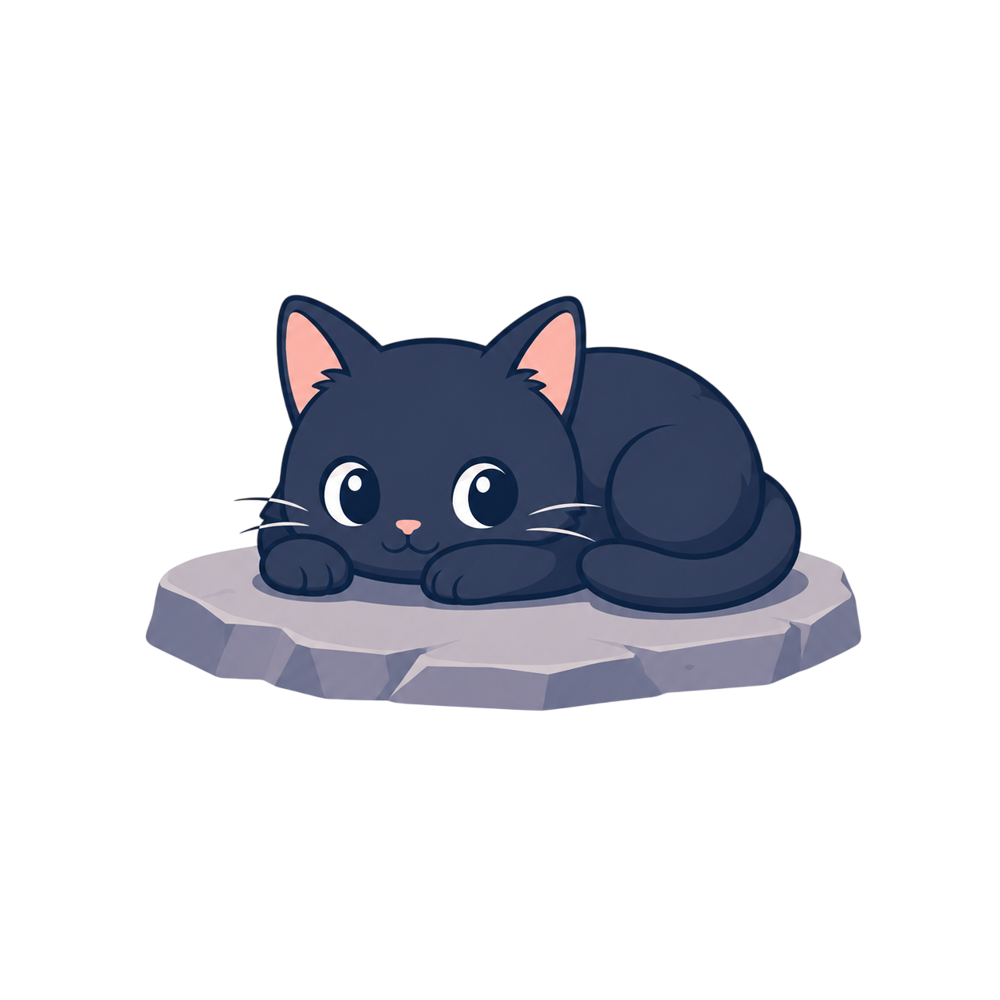

<p align="center">
  
</p>

# 猫影短剧 · NovelVids

**开源 AI 漫剧与短剧创作工作台。**

从故事、角色资产、分镜设计，到 AI 图片、视频生成与成片，把整个创作过程放进一个**可编辑、可追踪、能反复打磨的项目**。

[](LICENSE)
[](#快速开始)
[](docs/english-production.md)

<p align="center">
  <a href="README.en.md">English</a> &nbsp;|&nbsp; <strong>简体中文</strong>
</p>

[看成品](#先看效果) · [在线体验](https://demo.xiazq.com) · [本地部署](#快速开始) · [文档](#文档中心) · [参与贡献](CONTRIBUTING.md)

## 先看效果

[](https://youtu.be/fdiw__J19uk)

[观看完整片段（YouTube）](https://youtu.be/fdiw__J19uk) · 书稿导入 → 角色与场景 → 分镜 → 逐镜头生成 → 成片。实际效果取决于素材、模型和创作调整。

**先逛一遍再决定安装：**[打开在线演示](https://demo.xiazq.com)，账号 `demo`，密码 `NovelVids-Demo-2026`。演示站只读，可看已有项目、资产、分镜和视频，不提供免费生成；每天北京时间 00:00 重置。请勿填写私人数据。

## 在一个项目里完成创作

| 从哪里开始 | 你可以做什么 |
| --- | --- |
| 一段故事或小说 | 导入 TXT、Markdown、DOCX、PDF，检查分章与故事分析，逐章推进 |
| 角色、场景与道具 | 管理参考图、别名、变装与衍生形态，复用同一资产和声音绑定 |
| 一组分镜 | 编辑镜头描述、完整提示词、参考素材和生成参数，检查每次结果 |
| 一张无限画布 | 连接素材、视频与高清结果，在故事板和工作流之间切换 |
| 一个修改想法 | 让创作助手调整指定对象，查看差异、保存回执与可撤销修改 |
| 已生成的视频 | 跟踪任务与版本、衔接镜头、合并章节成片，按需做画质增强 |

也可以从有权使用的参考视频进入**重制工坊**，分析镜头并建立可编辑的创作项目。

### 为什么用工作台，而不是把过程散在几个工具里？

- **设定可以复用。** 角色、形态、场景和声音与分镜关联，跨章节沿用项目资产。
- **每一步可以修改。** 保留提示词与生成版本；可以只调整一个镜头，再决定是否生成。
- **按钮与对话用同一套能力。** 创作助手负责编排，图片和视频模型负责生成，任务与用量有记录。
- **规则可以自己改。** 故事、资产、生图和分镜规则集中在一套中文 Skills；按系统语言输出中文或英文。
- **服务由你配置。** 在自己的电脑或服务器部署，选择适合预算与创作风格的模型。

### 真实界面

**无限画布：把角色、场景、道具和镜头关系放在一起。**

[](docs/images/screenshots/workbench.png)

| 角色与场景资产 | 创作助手与分镜编辑 |
| --- | --- |
| [](docs/images/screenshots/asset.png) | [](docs/images/screenshots/creation-agent.png) |

点击查看原图。[更多界面](docs/screenshots.md)。截图为中文界面，系统也支持英文。

## 快速开始

需要 Docker 与 Docker Compose，以及可用的模型服务。**自部署不等于离线推理**：当前 AI 能力通过你配置的 API 调用，供应商可能收费。

```bash
git clone https://github.com/Anning01/novelvids.git
cd novelvids
docker compose up -d --build
```

启动后打开 **[http://localhost:8080](http://localhost:8080)**。

首次创作前：

1. 在「设置 → 模型配置」添加并启用文本模型，勾选「创作助手」和「支持多轮工具调用」；在通用设置中启用助手。
2. 配置要使用的图片、视频模型和价格。只配置文本模型，也可以先做故事、资产和分镜规划。
3. 从一段短故事或一章正文开始，检查提取与分镜结果，再生成媒体。明确的生成请求会调用付费模型；只改提示词不会自动生图或生视频。

当前 Docker 后端镜像未预装 FFmpeg。首次使用视频探测、合并、重制或高清化前，需在后端容器安装：

```bash
docker compose exec -u root backend sh -c 'apt-get update && apt-get install -y --no-install-recommends ffmpeg && rm -rf /var/lib/apt/lists/*'
docker compose exec backend ffprobe -version
```

这是当前镜像的准备步骤，重建后端镜像后需重新执行。完整配置和排错见[模型与首次启动指南](docs/model-configuration.md)。

- **数据在本地：**`./data` 保存数据库和私有导出，`./media` 保存图片、视频、音频；更新前备份这两个目录。
- **默认无登录：**适合个人本地使用。公网部署请先按[登录与团队部署指南](docs/team-auth-deployment.md)启用鉴权和 HTTPS。
- **本地开发：**Python 3.12+、Node.js 22.12+、uv 与 FFmpeg，见[开发指南](docs/development.md)。

## 创作流程


故事板适合逐镜头检查，画布适合组织引用与工作流。开始生成后可以关闭页面，后台继续查询已受理任务；结果不确定时需核对，不会自动重复提交收费请求。

## 文档中心

| 你想做什么 | 指南 |
| --- | --- |
| 了解功能、创作助手、声音与工作区入口 | [创作指南](docs/creation-guide.md) |
| 配置模型、价格和助手运行预算 | [模型与首次启动](docs/model-configuration.md) |
| 做英文对白、上传 MP3/WAV、跨章节复用声音 | [English production guide](docs/english-production.md)（英文） |
| 调整生图、分镜效果或新增风格 | [单套 Skills 开发指南](docs/agent-skills-workflow.md) |
| 把单条视频或成片提升到更高清晰度 | [视频画质增强](docs/video-enhancement.md) |
| 配置 PostgreSQL、OSS、媒体持久化与回填 | [数据库与媒体存储](docs/storage.md) |
| 启用登录、团队、权限与部署安全设置 | [团队部署](docs/team-auth-deployment.md) |
| 接入开发、了解结构与运行测试 | [开发指南](docs/development.md) · [贡献指南](CONTRIBUTING.md) |
| 查阅专项行为 | [媒体资源库](docs/resource-library.md) · [项目统计](docs/project-overview.md) · [项目名称迁移](docs/project-name-scoping.md) |

## 开发与社区

前端使用 **Vue 3、TypeScript、Vue Flow**，后端使用 **FastAPI、Tortoise ORM、Pydantic AI**。创作规则位于 [`prompts/skills/`](prompts/skills/)，模型适配与任务执行保持独立。

欢迎带着实际创作问题参与：[报告问题](https://github.com/Anning01/novelvids/issues/new) · [讨论需求](https://github.com/Anning01/novelvids/issues) · [提交贡献](CONTRIBUTING.md)。报告生成问题时，提供可公开的最小样例、模型配置类型和复现步骤，别附 Key 或私人素材。

后续重点围绕**资产一致性、可复现工作流、部署恢复、模型与 Skills 扩展、成片质量检查**讨论和推进；当前能力与待讨论方向分开记录在[路线图](ROADMAP.md)，不作为交付承诺。

如果 NovelVids 帮到了你，欢迎 Star、反馈使用体验，或分享有权公开的作品与制作过程。

## 许可证

项目代码和文档采用 **[MIT License](LICENSE)**，允许商业使用、修改与再分发，须保留版权及许可声明。软件按原样提供，不附带保证。

第三方依赖、字体、素材和模型服务仍遵循各自许可；演示内容不代表授予第三方小说、音乐或声音的使用权，详见[第三方声明](NOTICE.md)。

## Star 历史

<!-- star-growth-card:start -->
<p align="center">
  <a href="https://github.com/Anning01/novelvids/stargazers">
    
  </a>
</p>
<!-- star-growth-card:end -->
