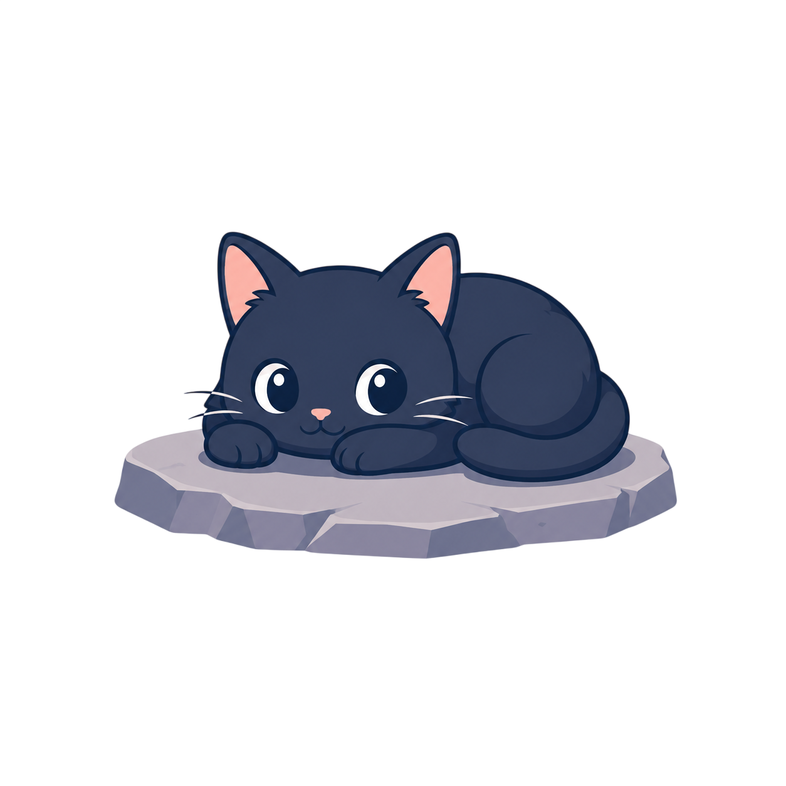
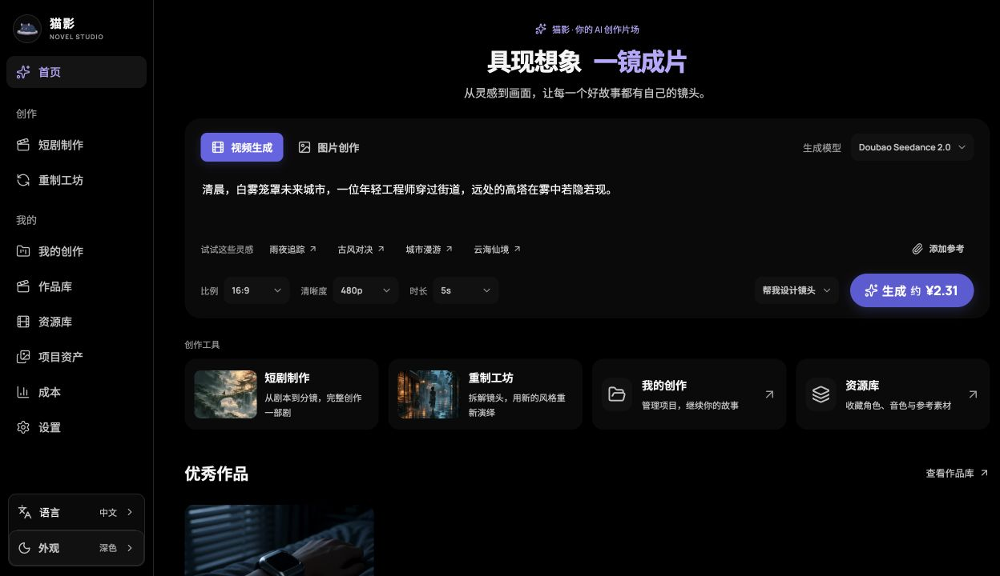
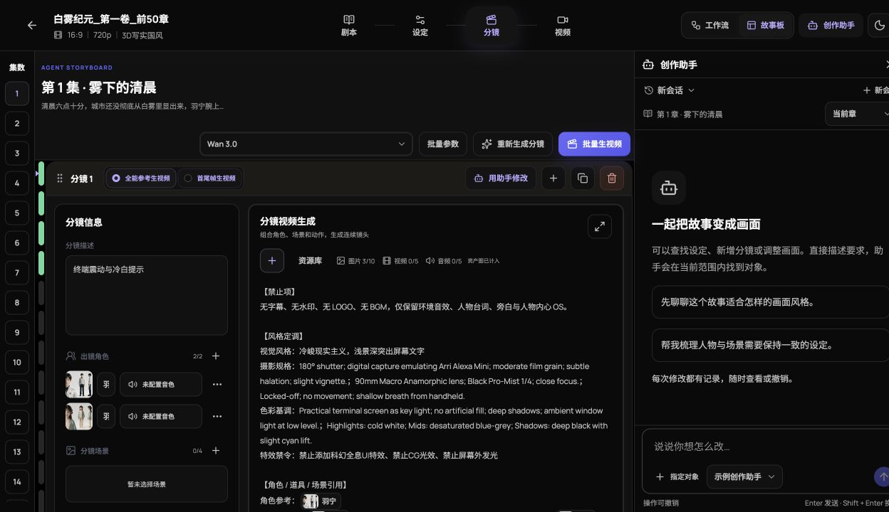
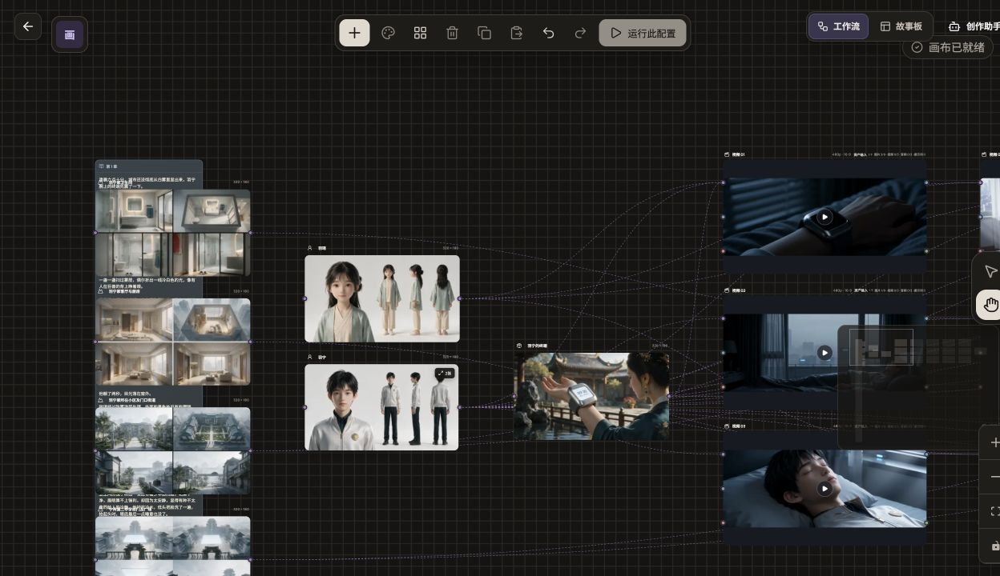
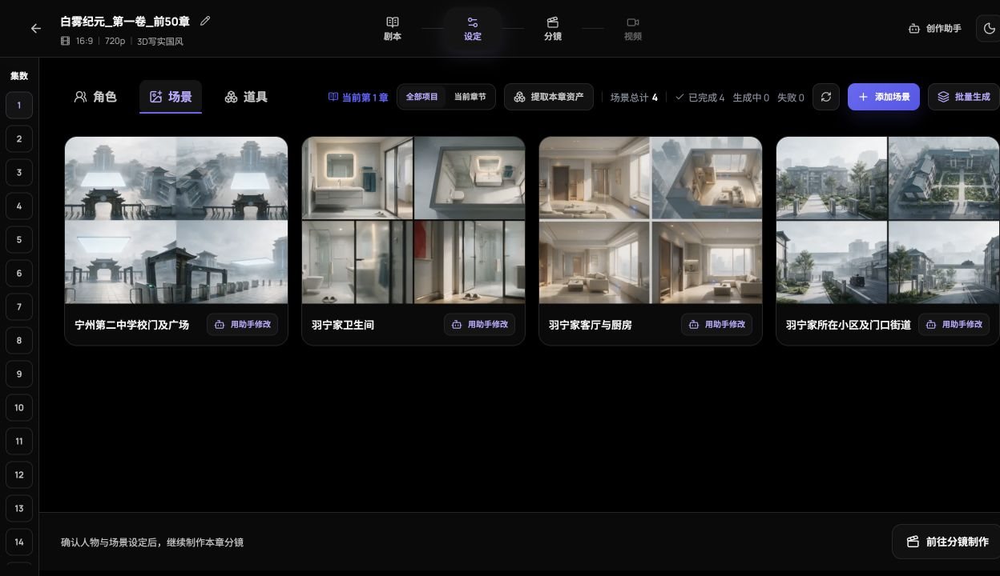
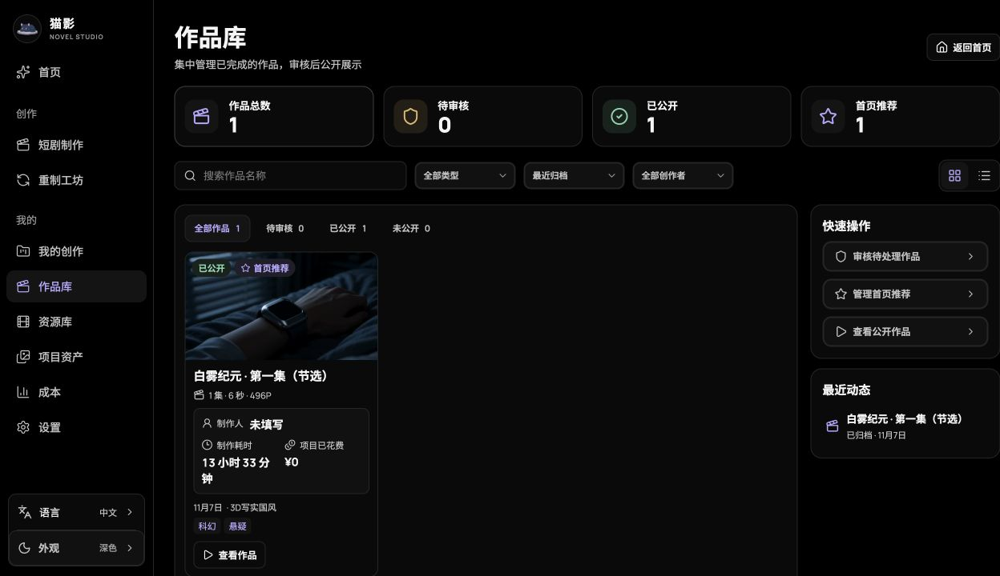
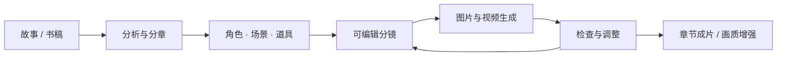

<p align="center">
  
</p>

<h1 align="center">猫影短剧 · NovelVids</h1>

<p align="center">
  <strong>开源 AI 漫剧与短剧工作台，在本地管理作品，可接入自有模型或猫影开放平台。</strong>
</p>

<p align="center">
  从故事、角色资产、分镜设计，到 AI 图片、视频生成与成片，<br>
  把整个创作过程放进一个<strong>可编辑、可追踪、能反复打磨的项目</strong>。
</p>

<p align="center">
  <a href="LICENSE"></a>
  <a href="https://shortdramas.xiazq.com"></a>
  <a href="README.en.md"></a>
</p>

<p align="center">
  <a href="README.en.md">English</a> &nbsp;|&nbsp; <strong>简体中文</strong>
</p>

<p align="center">
  <a href="#快速开始">快速开始</a> · <a href="#加入交流群">加入交流群</a> · <a href="#使用教程">使用教程</a> · <a href="#作品示例">作品示例</a> · <a href="https://shortdramas.xiazq.com">进入商业站</a> · <a href="#本地开发">本地开发</a> · <a href="#开发与社区">参与贡献</a> · <a href="#赞赏支持">赞赏支持</a>
</p>

## 快速开始

选一种用法，把对应的一句话发给 AI。

**下载并使用猫影工作台**

```text
请从 https://github.com/Anning01/novelvids 下载并用 Docker 部署猫影工作台，在支持的 Linux 主机上用仓库自带的 scripts/update/install.sh 一并启用在线升级，验证部署结果后把工作台地址和小说导入入口发给我。
```

**单独使用创作 Skills**

```text
请用 https://github.com/Anning01/novelvids 里的 scripts/export_skill.py，把剧本改编、资产设定和分镜设计三个 Skills 安装到我当前的创作项目，然后告诉我怎么用它们处理第一章小说。
```

## 加入交流群

欢迎加入 **猫影短剧 · NovelVids 微信交流群**，交流 AI 漫剧、短剧制作、模型使用与开源部署。

<p align="center">
  <a href="docs/images/wechat-group-qr.jpg"></a>
</p>

<p align="center">
  微信扫码入群 · <strong>当前二维码于 2026 年 11 月 8 日更新，11 月 15 日前有效。</strong><br>
  二维码有效期为 7 天；如已失效，请查看仓库首页的最新版本。
</p>

## 猫影服务

**[进入猫影商业站 →](https://shortdramas.xiazq.com)**

使用器灵账号微信扫码登录。新版开放平台提供模型目录、接口文档、API Key、用量和充值。旧作品的迁移入口见「本地工作台和开放平台」。

本仓库提供猫影创作工作台与创作规则。模型开放平台已独立为 [Cat API](https://github.com/Anning01/cat-api)。本地工作台的账号、团队和余额由部署者管理，平台账号与模型调用费用由 Cat API 独立管理。

## 使用教程

**[观看 B 站使用教程 →](https://www.bilibili.com/video/BV12JW76dEkj/)**

想了解猫影短剧怎么用，可以先看视频教程；生成的成片效果见下方「作品示例」。

## 作品示例

**商业复刻示例**

[](https://www.bilibili.com/video/BV1U74P6hEpx/)

[在 B 站观看商业复刻示例](https://www.bilibili.com/video/BV1U74P6hEpx/)

**漫剧制作示例**

[](https://www.bilibili.com/video/BV1U74P6hEzD/)

[在 B 站观看漫剧制作示例](https://www.bilibili.com/video/BV1U74P6hEzD/) · 视觉风格：3D仙侠；分镜策略：旁白叙事。从故事到成片自动生成，全程没有人工修改提示词或 AI 生成的 Prompt。实际效果取决于素材、模型和创作调整。

## 在一个项目里完成创作

| 从哪里开始 | 你可以做什么 |
| --- | --- |
| 一句画面描述 | 从首页选择图片或视频模型，引用图片、视频或音频，查看报价并生成独立片段 |
| 一段故事或小说 | 导入 TXT、Markdown、DOCX、PDF，检查分章与故事分析，逐章推进 |
| 角色、场景与道具 | 管理参考图、别名、变装与衍生形态，复用同一资产和声音绑定 |
| 一组分镜 | 编辑镜头描述、完整提示词、参考素材和生成参数，检查每次结果 |
| 一张无限画布 | 连接素材、视频与高清结果，在故事板和工作流之间切换 |
| 一个修改想法 | 让创作助手调整指定对象，查看差异、保存回执与可撤销修改 |
| 已生成的视频 | 跟踪任务与版本、衔接镜头、合并章节成片，按需做画质增强 |

也可以从有权使用的参考视频进入**重制工坊**，分析镜头并建立可编辑的创作项目。

### 为什么用工作台，而不是把过程散在几个工具里？

- **设定可以复用。** 角色、形态、场景和声音与分镜关联，跨章节沿用项目资产。
- **每一步可以修改。** 保留提示词与生成版本；可以只调整一个镜头，再决定是否生成。
- **按钮与对话用同一套能力。** 创作助手负责编排，图片和视频模型负责生成，任务与用量有记录。
- **规则可以自己改。** 故事、资产、生图和分镜规则集中在一套中文 Skills；按系统语言输出中文或英文。
- **模型可选。** 作品保存在本地，可使用自有模型服务，也可配置猫影开放平台。

### 新版界面

**首页：选择模型、引用素材，从图片或视频片段开始。**

[](docs/images/screenshots/home.jpg)

| 分镜与创作助手 | 无限画布工作流 |
| --- | --- |
| [](docs/images/screenshots/creation-agent.jpg) | [](docs/images/screenshots/workbench.jpg) |

| 项目资产 | 作品库 |
| --- | --- |
| [](docs/images/screenshots/asset.jpg) | [](docs/images/screenshots/portfolio.jpg) |

截图使用公开示例项目，展示当前版本的中文界面；系统也支持英文。

## 本地工作台和开放平台

本仓库部署创作工作台，默认使用 `NOVELVIDS_ROLE=studio`。开放平台请使用独立的 [Cat API 项目](https://github.com/Anning01/cat-api)。在项目列表的更多操作中选择「导出作品」，在另一套本地工作台选择「导入作品」即可恢复为新项目。云端素材由导出浏览器直接下载，存储域名需允许该工作台来源的跨域读取。

在平台控制台创建用途为「本地猫影」的 API Key，然后用工作台超级管理员打开「模型配置 → 连接开放平台」，填入 Key 并同步模型。工作台默认连接 `https://shortdramas.xiazq.com/v1`，也可通过 `STUDIO_PLATFORM_BASE_URL` 指定其他平台地址。成片由工作台直接下载并保存在本地。

旧版本的 `NOVELVIDS_ROLE=platform` 仅为已有部署保留兼容，新部署应分别安装工作台与 Cat API。旧站用户可登录 [历史作品迁移](https://shortdramas.xiazq.com/#/legacy-works) 下载完整作品包，再导入本地工作台。切换服务前应保留原作品和媒体，预留迁移时间并提前通知用户。

## 创作流程



故事板适合逐镜头检查，画布适合组织引用与工作流。开始生成后可以关闭页面，后台继续查询已受理任务；结果不确定时需核对，不会自动重复提交收费请求。

## 本地开发

需要 Python 3.12+、Node.js 22.12+、uv 与 FFmpeg。

```bash
uv sync --frozen --dev
make dev PORT=9000
```

另开终端启动前端：

```bash
cd web
npm ci
npm run dev
```

打开 [http://localhost:3000](http://localhost:3000)。前端代理指向本地后端的 9000 端口。

## 开发与社区

前端使用 **Vue 3、TypeScript、Vue Flow**，后端使用 **FastAPI、Tortoise ORM、Deep Agents 和 Pydantic AI**。创作规则位于 [`prompts/skills/`](prompts/skills/)，模型适配与任务执行保持独立。

欢迎带着实际创作问题参与：[报告问题](https://github.com/Anning01/novelvids/issues/new) · [讨论需求](https://github.com/Anning01/novelvids/issues) · [提交贡献](https://github.com/Anning01/novelvids/pulls)。报告生成问题时，提供可公开的最小样例、模型配置类型和复现步骤，别附 Key 或私人素材。

后续重点围绕**资产一致性、可复现工作流、部署恢复、模型与 Skills 扩展、成片质量检查**讨论和推进。

如果 NovelVids 帮到了你，欢迎 Star、反馈使用体验，或分享有权公开的作品与制作过程。

## 赞赏支持

如果这个项目对你有帮助，欢迎通过微信或支付宝赞赏，支持我继续开发和维护猫影短剧。感谢你的支持！

| 微信支付 | 支付宝 |
| :---: | :---: |
| <a href="docs/images/donate-wechat.jpg"></a> | <a href="docs/images/donate-alipay.jpg"></a> |

## 许可证

项目代码和文档采用 **[MIT License](LICENSE)**，允许商业使用、修改与再分发，须保留版权及许可声明。软件按原样提供，不附带保证。

第三方依赖、字体、素材和模型服务仍遵循各自许可；演示内容不代表授予第三方小说、音乐或声音的使用权，详见[第三方声明](NOTICE.md)。

## Star 历史

<!-- star-growth-card:start -->
<p align="center">
  <a href="https://github.com/Anning01/novelvids/stargazers">
    
  </a>
</p>
<!-- star-growth-card:end -->

创作助手的新会话由 Python Deep Agents 管理工具循环、按需技能加载和上下文整理，业务工具继续校验权限、版本和输出协议。会话检查点默认保存在 `data/creation_agent_checkpoints.db`，可用 `CREATION_AGENT_CHECKPOINT_PATH` 指定位置；需要保留长会话恢复能力时，请将该状态文件纳入备份。历史运行保留原执行路径。
