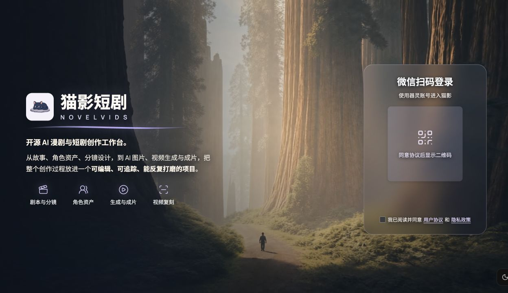
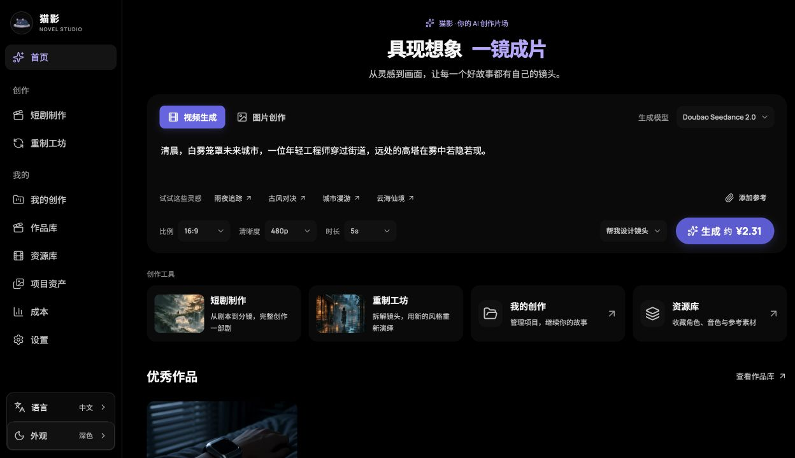
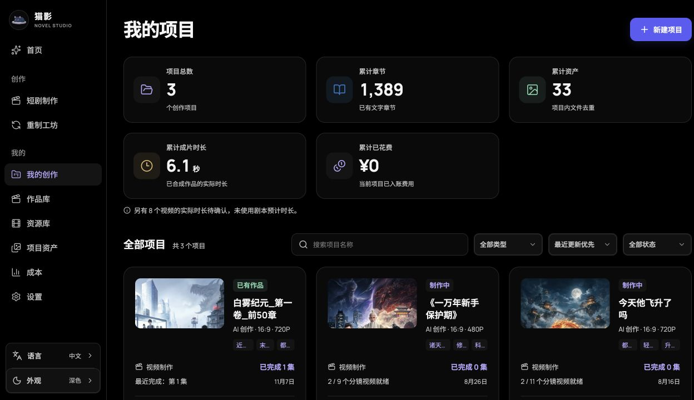
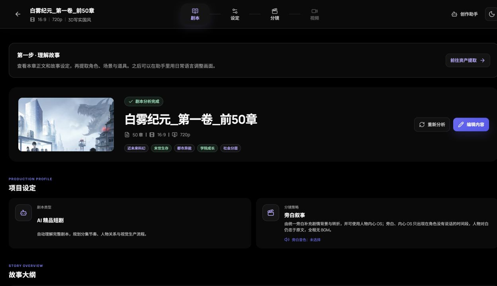
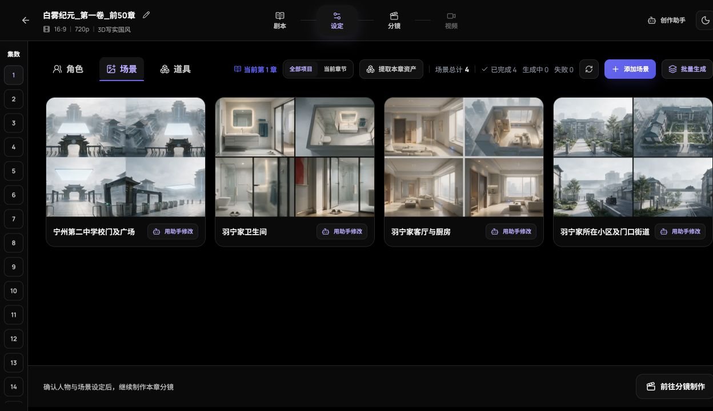
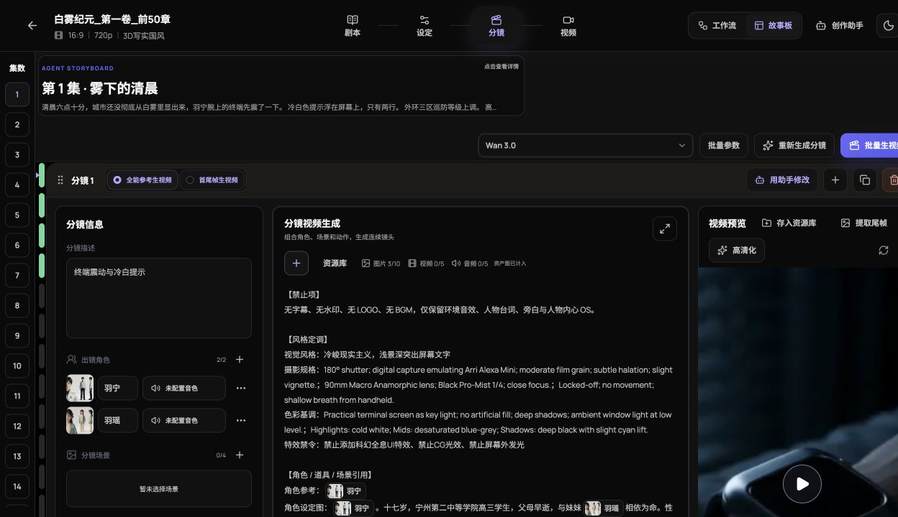
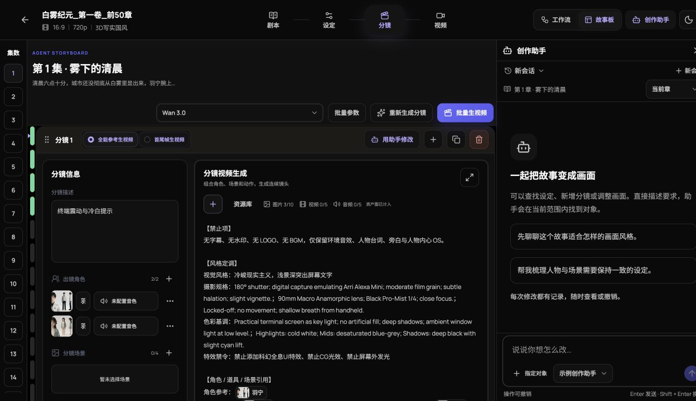
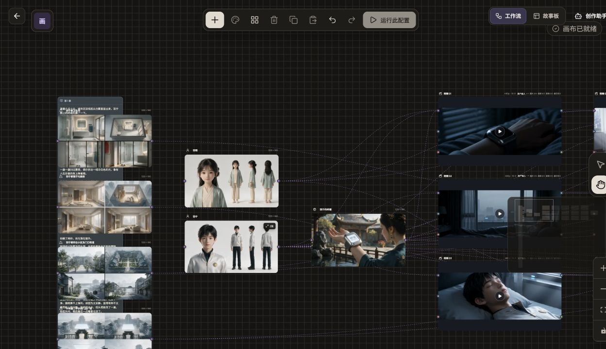
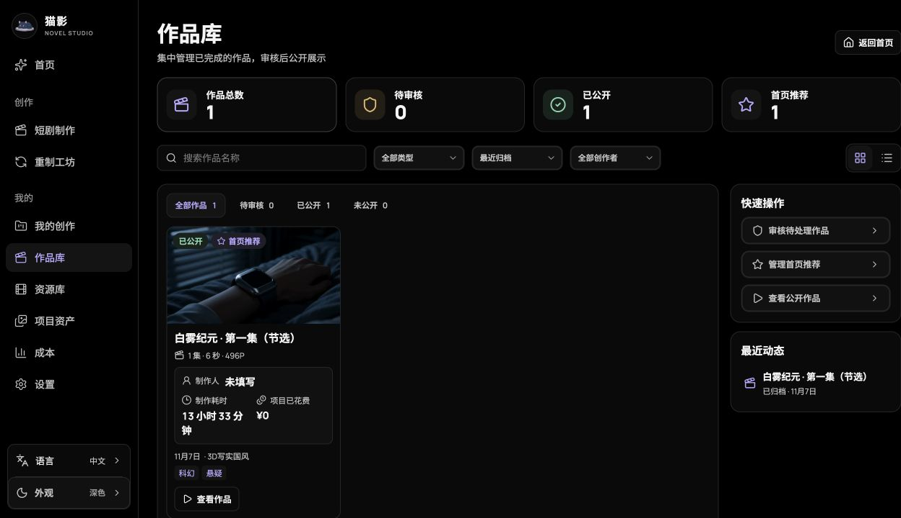
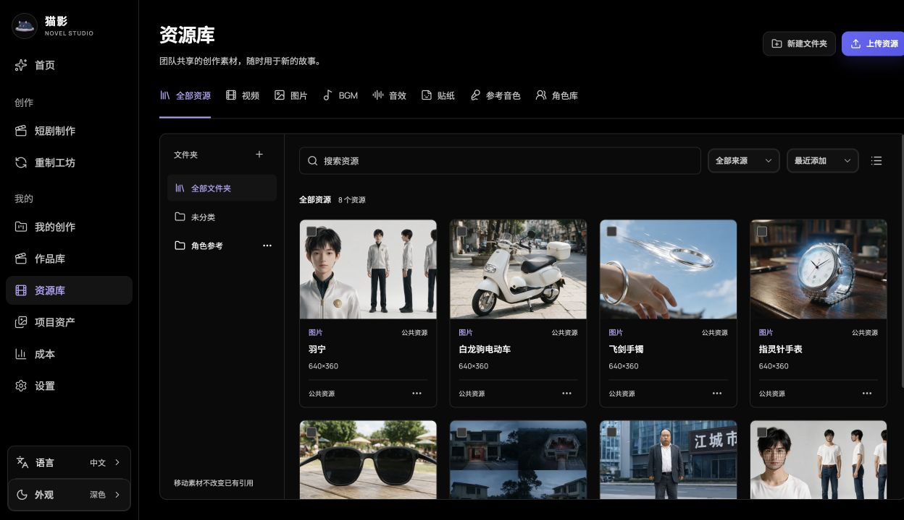

# 新版界面预览 / Screenshots

[中文 README](../README.md) · [English README](../README.en.md) · [进入猫影商业站](https://shortdramas.xiazq.com)

以下截图更新于 **2026-11-07**，展示新版中文界面与统一黑色主题。创作页面使用已公开示例项目的独立展示副本，不包含真实账号、密钥或私人账单。模型、价格与可用功能以商业站当前显示为准；系统也支持英文。

Screenshots show the current Chinese interface with public example data. English is also supported. Available models and prices follow the live commercial service.

## 在线登录与首页

### 器灵微信扫码登录 / Qiling sign-in

商业站通过器灵微信授权登录；阅读并同意协议后获取二维码。

### 首页图片与视频创作 / Image and video creation

选择模型、画面比例、清晰度与时长，输入想法或引用素材，查看费用后提交创作。首页同时展示创作入口和已公开作品。

## 从故事到分镜

### 我的创作 / My projects

项目卡片汇总创作状态、资产、成片与已入账费用，支持搜索、排序和继续编辑。

### 故事与项目设定 / Story and production profile

在同一项目中查看剧情分析、分集正文、人物小传、视觉风格和分镜策略。

### 项目资产 / Project assets

角色、场景与道具按项目和章节组织，已有参考图与后续镜头共享。

### 可编辑分镜 / Editable storyboard

按集检查镜头描述、角色引用、完整提示词、模型参数与视频结果。

### 创作助手 / Creation assistant

助手与分镜并排展示，可以选择作用范围、模型和修改对象，使用自然语言描述调整要求。

### 无限画布 / Infinite canvas

在同一工作流中组织场景、角色、道具与视频镜头，查看引用连线，按需要缩放和整理布局。

## 成片与素材复用

### 作品库 / Works library

按作品归档成片，管理公开状态、审核和首页推荐。截图中的视频为已有公开示例节选。

### 资源库 / Resource library

按文件夹与素材类型整理图片、视频、BGM、音效、贴纸、音色及角色资料，复用于后续创作。

