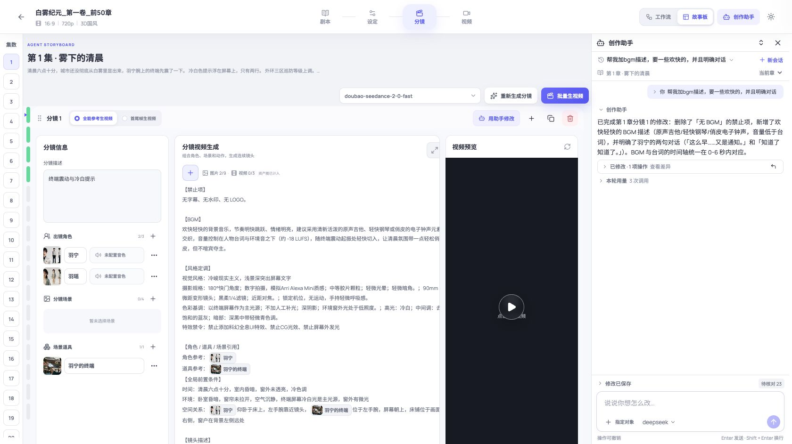
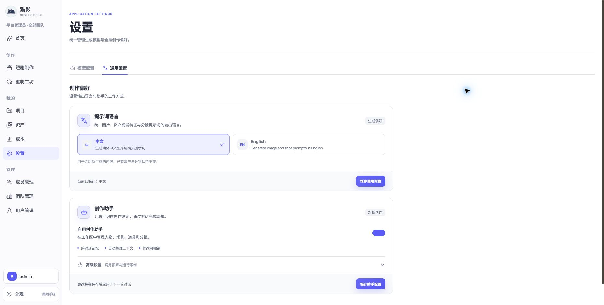
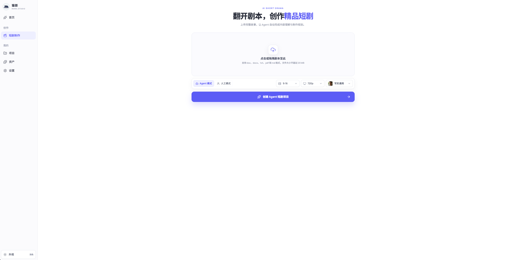
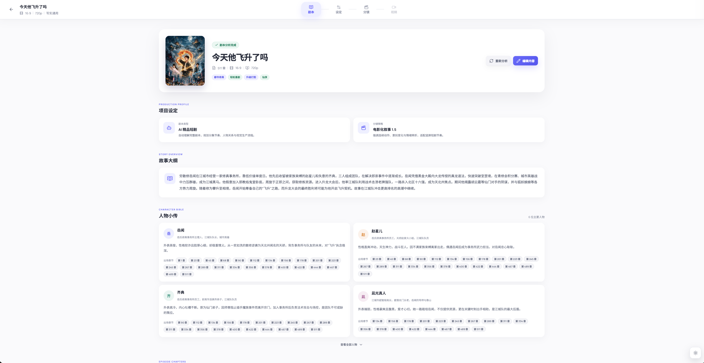
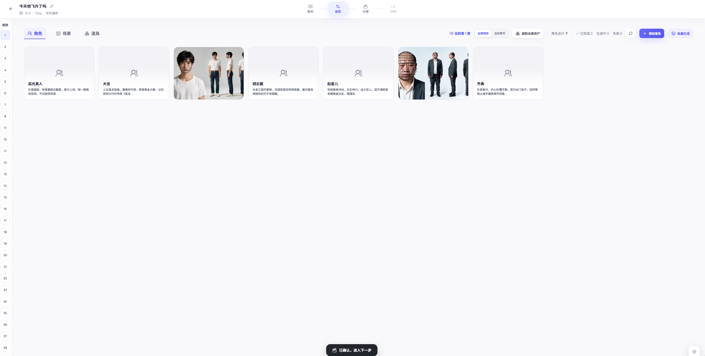
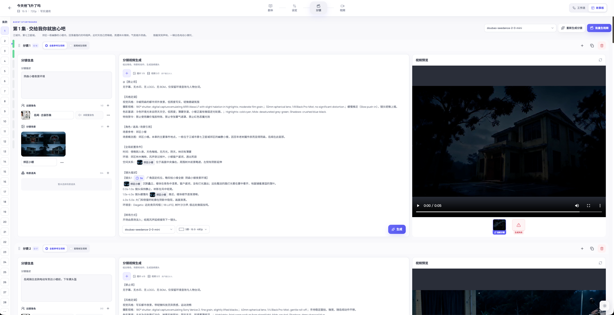
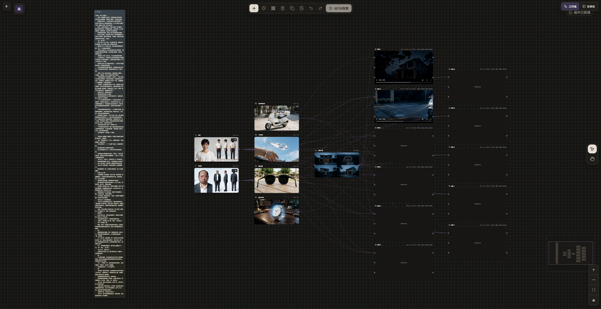
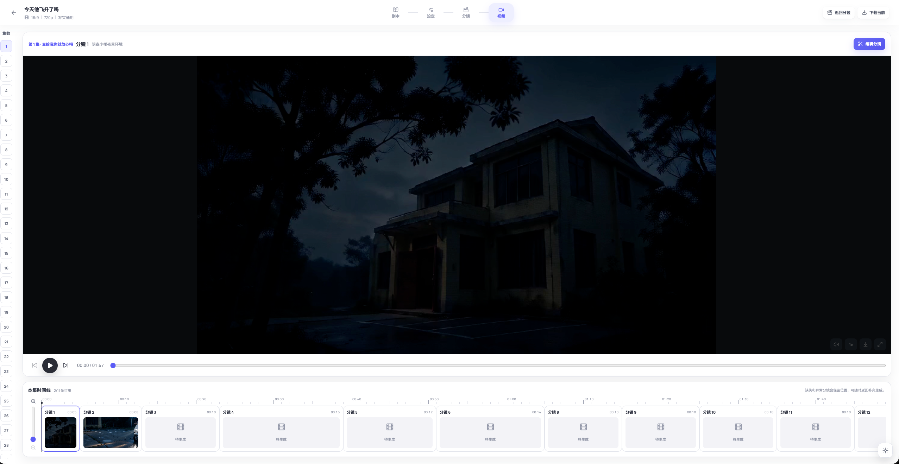
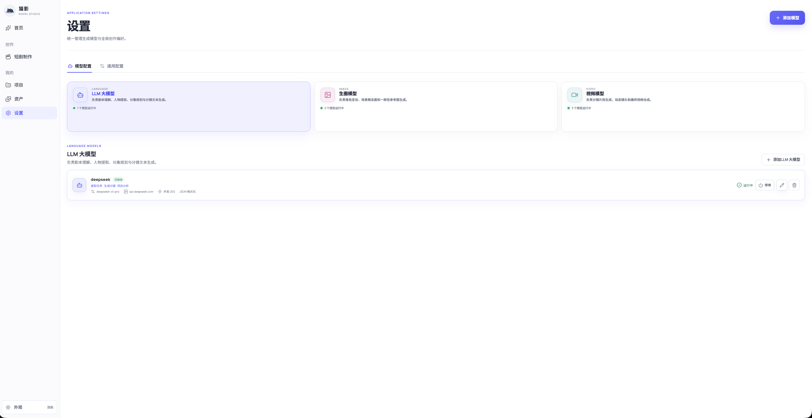
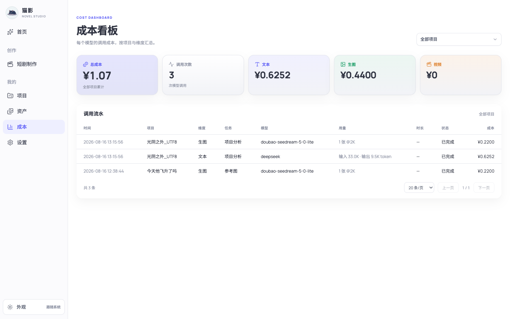

# 界面预览 / Screenshots

[中文 README](../README.md) · [English README](../README.en.md)

以下为真实界面截图。点击首页中的预览图可查看原图；实际界面可能随版本调整。Screenshots show the Chinese interface; layouts may change across versions.

### 创作助手与设置

对话与分镜并排查看，底部选择模型与引用对象，回复中的操作记录和用量支持折叠。

通用配置统一管理提示词语言、助手启用状态和运行限制。

### 其他页面

<table>
  <tr>
    <td align="center"><b>首页</b></td>
    <td align="center"><b>项目列表</b></td>
  </tr>
  <tr>
    <td></td>
    <td></td>
  </tr>
  <tr>
    <td align="center"><b>小说详情</b></td>
    <td align="center"><b>资产管理</b></td>
  </tr>
  <tr>
    <td></td>
    <td></td>
  </tr>
  <tr>
    <td align="center"><b>分镜编辑（故事版）</b></td>
    <td align="center"><b>无限画布工作流</b></td>
  </tr>
  <tr>
    <td></td>
    <td></td>
  </tr>
  <tr>
    <td align="center"><b>视频生成</b></td>
    <td align="center"><b>模型配置</b></td>
  </tr>
  <tr>
    <td></td>
    <td></td>
  </tr>
  <tr>
    <td align="center" colspan="2"><b>成本看板</b></td>
  </tr>
  <tr>
    <td colspan="2"></td>
  </tr>
</table>
